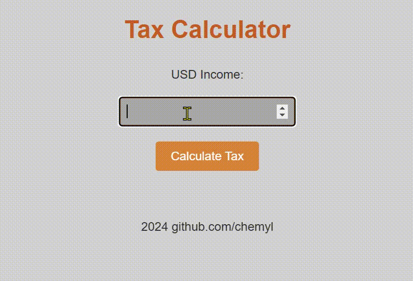

An experiment using [wasm-bindgen](https://crates.io/crates/wasm-bindgen) to create a WebAssembly program. Built with `wasm-bindgen 0.2.95`.

[GitHub Repository](https://github.com/maltsev-dev/tax_app_webassembly)

## Tools

- `rust 1.83.0`
- `wasm_test 0.3`
- [CI](https://github.com/chemyl/tax_app_webassembly/actions/workflows/rust.yml)

## How to build and run

1. Create a library crate:

   ```bash
   cargo new project --lib
   ```

2. Add the crate type annotation for the compiler:

   ```toml
   [lib]
   crate-type = ["cdylib"]
   ```

3. Create a basic `index.html` skeleton and extend the script block to handle loading and interacting with the wasm module.

4. Install wasm-pack:

   ```bash
   cargo install wasm-pack
   ```

5. Build the project with wasm-pack:

   ```bash
   wasm-pack build --target web
   ```

6. Install a simple web server globally (if not installed):

   ```bash
   npm install -g http-server
   ```

7. Start the web server from the project root folder:

   ```bash
   http-server .
   ```



## License

This project is licensed under the [MIT License](https://github.com/maltsev-dev/tax_app_webassembly?tab=MIT-1-ov-file).
