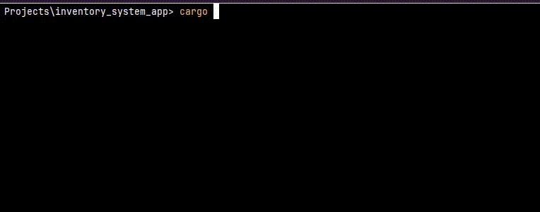

**An old-school terminal-based inventory management system built with Rust and [Cursive](https://crates.io/crates/cursive).**  
`cursive 0.21.1`

---

## 🖥️ Text-based user interface (TUI) inventory system

[📚 GitHub Repository](https://github.com/maltsev-dev/inventory_system_app)

This project is an experiment in building a **Text User Interface** application using the [Cursive](https://github.com/gyscos/cursive) library — a powerful TUI framework for Rust. Inspired by classic terminal apps, it offers a practical solution for managing a simple inventory of products with full keyboard interaction.

Ideal for Rust learners and enthusiasts exploring terminal UI development.

---

### ⚙️ Tools & stack

<h3 style="text-align:center; margin-bottom:8px;">Tools</h3>
<p align="center" style="margin:0; padding:0;">
  <code>rust 1.83.0</code>
  <code>cursive 0.21.1</code>
  <a href="https://github.com/chemyl/inventory_system_app/actions/workflows/rust.yml"><code>CI</code></a>
</p>

---

## ✨ Features

1. **Create and Save Items**

   * Define product type
   * Set quantity
   * Input price per unit

2. **Display All Items**

   * View inventory in a structured list
   * Automatically calculate total price and sales tax

3. **Delete Items**

   * Remove an item by specifying its ID

4. **Local JSON-based Database**

   * Persistent storage using a flat file database
   * File path defined as:

     ```rust
     const FILE_PATH: &str = "products.json";
     ```

---

### 🖼️ Demo



---

## 📦 Installation & run

1. **Clone the Repository**

   ```bash
   git clone https://github.com/maltsev-dev/inventory_system_app
   cd inventory_system_app
   ```

2. **Build the Project**

   ```bash
   cargo build --release
   ```

3. **Run the App**

   ```bash
   cargo run
   ```

---

## 📄 License

This project is licensed under the **MIT License** — free to use, modify, and distribute.