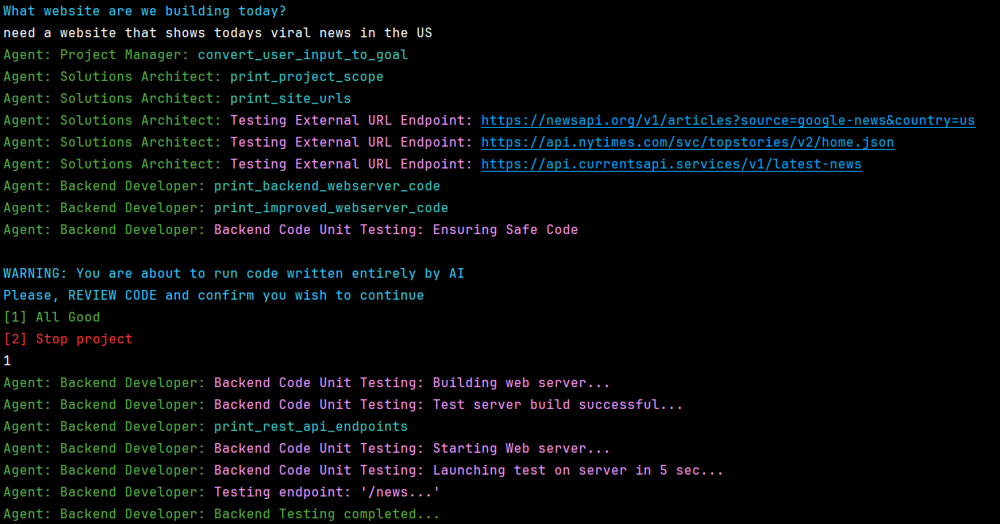

RestOn is an agent that generates backend code from a text query. It is built in Rust on top of Actix-web.

[Effortless Backend Prototyping with Rust](https://www.linkedin.com/pulse/effortless-backend-prototyping-rust-anatolii-maltsev-hvvce/?trackingId=lGXFeD6ET%2ByFSocPHYS9qg%3D%3D)
[Documentation](https://github.com/maltsev-dev/rest_on)
[rest_on](https://github.com/maltsev-dev/rest_on)

The agent automates the generation of backend code for projects and prototypes. It handles both a simple `CRUD app` and a more involved `SAAS platform`.

## Features

- Automatic code generation. Uses the GPT API to generate backend code for services built with `actix-web` and other popular Rust libraries.
- CRUD operations. Generates the standard operations for data manipulation (Create, Read, Update, Delete).
- Template flexibility. Adapts the web server templates to different requirements.
- Ease of use. A simple interface to interact with the project.

## Tools

- `rust 1.83.0`
- `actix_web 4.9.0`
- `tokio 1.28.0`
- `reqwest 0.12.10`
- `serde 1.0.160`
- `actix_cors 0.7.0`
- `dotenv 0.15.0`
- `crossterm 0.28.1`
- `async-trait 0.1.83`
- `webbrowser 1.0.3`
- `ai_functions 0.1.1`

The crates carry the work:

- Rust, the primary programming language for building fast, secure and concurrent services
- Actix-web, a web framework for building web applications in Rust
- Tokio, an asynchronous runtime for Rust, used for parallel task handling and async calls
- Reqwest, an HTTP client for interacting with external APIs
- GPT API, used for generating code and executing tasks based on text-based queries

## Installation

1. Clone the repository:

   ```bash
   git clone https://github.com/chemyl/auto_gpt_agent.git
   cd auto_gpt_agent
   ```

2. Install Rust (if not already installed):

   ```bash
   curl --proto '=https' --tlsv1.2 -sSf https://sh.rustup.rs | sh
   ```

3. Install dependencies:

   ```bash
   cargo build
   ```

4. Add the OpenAI keys:

   ```text
       OPEN_AI_ORG
       OPEN_AI_KEY
   .env
   ```

5. Run the project:

   ```bash
   cargo run
   ```

## Usage

Send a text query to the system and it generates the backend code for you.

Example query:

```text
Create a webserver that shows today viral news in the US
```

After the backend code is generated, the agent asks for confirmation, then builds and tests the web server.

## Example usage



The generated `main` looks like this:

```rust
#[actix_web::main]
async fn main() -> std::io::Result<()> {
    let db: Database = Database::load_from_file().unwrap_or_else(|_| Database::new());
    let data: web::Data<AppState> = web::Data::new(AppState {
        db: Mutex::new(db)
    });

    HttpServer::new(move || {
        App::new()
            .wrap(
                Cors::permissive()
                    .allowed_origin_fn(|origin, _req_head| {
                        origin.as_bytes().starts_with(b"http://localhost") || origin == "null"
                    })
                    .allowed_methods(vec!["GET", "POST", "PUT", "DELETE"])
                    .allowed_headers(vec![header::AUTHORIZATION, header::ACCEPT])
                    .allowed_header(header::CONTENT_TYPE)
                    .supports_credentials()
                    .max_age(3600)
            )
            .app_data(data.clone())
            .route("/news", web::post().to(create_news))
            .route("/news", web::get().to(read_all_news))
            .route("/news", web::put().to(update_news))
            .route("/news/{id}", web::get().to(read_news))
            .route("/news/{id}", web::delete().to(delete_news))
    })
        .bind("127.0.0.1:8080")?
        .run()
        .await
}
```

## How it works

1. The project uses the GPT API to process text queries and generate code.
2. Queries are sent to the system, which generates backend code based on the input.
3. The code generation includes:
   - Creating a new HTTP server
   - Route creation for handling requests
   - Json Database setup
4. The generated code can be run directly on your server or further customized to fit your needs.

## Planned work

- Support for more complex templates. Generate more specialized services based on detailed templates.
- Command-line interface. A more advanced CLI for managing the project.
- Support for additional databases. Integration with MongoDB, MySQL, SQLite and others.
- CI/CD integration. Automate deployment pipelines.
- Project requirements. Perform in-depth client onboarding.
- Extend testing. Test all dynamic routes.
- Frontend development. A frontend automation agent based on Yew.
- Local LLM. Introduce local open source LLMs.

## Contributing

Contributions are welcome. If you have ideas to improve the project, create an [issue](https://github.com/chemyl/auto_gpt_agent/issues) or submit a pull request.

1. Fork the repository.
2. Create your feature branch (`git checkout -b feature-branch`).
3. Commit your changes (`git commit -am 'Add new feature'`).
4. Push to your branch (`git push origin feature-branch`).
5. Open a pull request.

## License

This project is licensed under the MIT License. See the [LICENSE](https://github.com/chemyl/auto_gpt_agent/blob/master/LICENSE) file for details.
