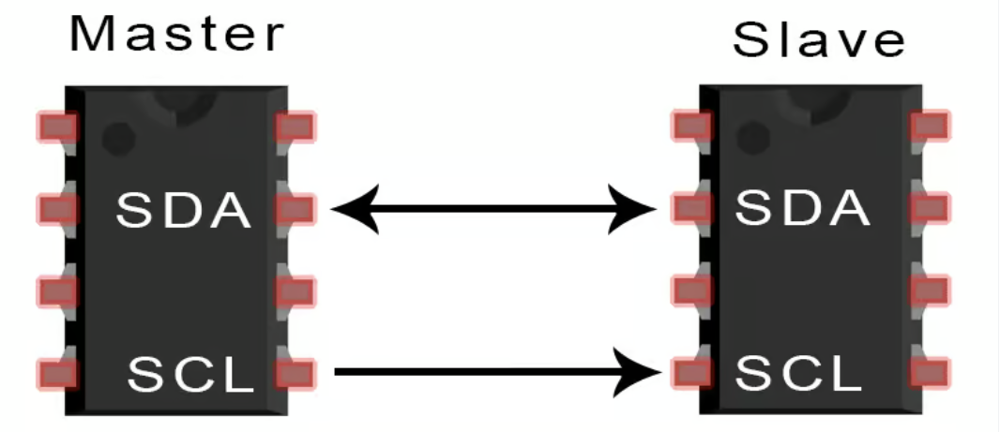
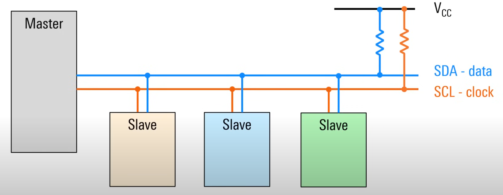
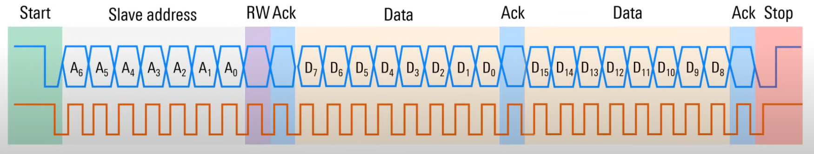
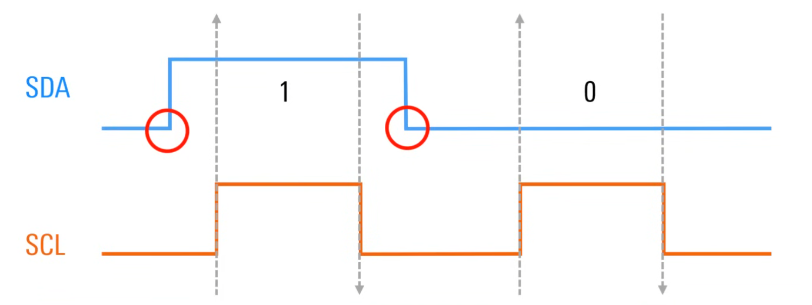
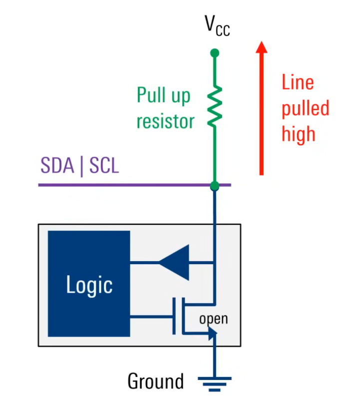

I2C (Inter-Integrated Circuit) is a low-speed two-wire master-slave serial protocol, widely used for short-distance data transmission over a data bus (`SDA`) with a clock synchronization line (`SCL`).

## Bus topology
I2C is the most common protocol for transmitting data over short distances. It is a synchronous `master-slave` protocol, and both the master and the slave can transmit data. It usually operates in `half-duplex` mode (at any given moment, only send or receive data can occur) at different clock frequencies. Message exchange occurs in `frames`.

Two wires are used:
- `SCL`: serial clock signal
- `SDA`: data bus

In addition, the wires are connected to the `Vcc` supply using one `pull-up` resistor.

## SDA frame format

1. The master captures the **SDA** bus with a `start condition`
2. The `slave address` the master wants to communicate with is sent via **SDA**
3. After the address comes the operation bit `R/W`, which says whether the master wants to read or write data
4. After the operation bit the slave sends `Arc`, indicating its presence
5. If `Arc` is received from the slave, the master sends the `useful data`
6. After the data the slave sends `Arc`, indicating that the data was received
7. Communication is stopped by a `stop condition`

### Start condition
As in [UART](/blog/2025-06-30-uart-universal-asynchronous-receiver-transmitter/), the `idle` state for **SDA** and **SCL** is `high(1)`. The `start condition` occurs when the node first pulls `low(0)` **SDA**, and then pulls `low(0)` **SCL**. Pulling down in this order captures the data bus.

After the data bus is captured the node becomes the **master**, which prevents other nodes from capturing the bus and reduces the risk of conflicts.

### Slave address
The slave address specifies which slave node the master wants to communicate with. Each node on the bus has a `unique fixed address`, usually `7 bits` with **MSB** first (the most significant bit is one). Addresses can be hardcoded, but sometimes they can be configured via wires.

### R/W bit
Immediately after the slave address comes the `read` or `write` bit, set by the master.
- `0`: the master wants to **write** data to the slave
- `1`: the master wants to **receive** data from the slave

### Ack bit
An acknowledge bit is sent by the receiver each time a byte of data is received.
- `0`: acknowledgement (ACK)
- `1`: negation (NACK)

I2C is `high(1)` in `idle`, so if the receiver does not respond by actively switching the line to `low(0)` level, it will be perceived as a failure. After the address and each byte of data received (`8-bit`), there is an acknowledgement Arc.

### Data bits
After the address bit come the **data bits** that are exchanged between the master and the slave. Often this data is a memory or register address in the slave. Data is always transmitted `8-bit` wide and MSB first. In most cases, multiple data transfers occur, with each `8-bit` having to be acknowledged separately.

### Stop condition
The stop condition is the mechanism for saying that the last byte of data has been sent.
- the **SCL** line goes `high(1)` and stays there
- then **SDA** goes `high(1)` and stays there too

To transmit data bytes, the **SDA** line goes `low(0)` only when **SCL** is at `low(0)` level. If the **SDA** line goes `low(0)` when **SCL** is at `high(1)` level, that is the `stop condition`.

After the stop condition the bus becomes inactive and there is no clock signal. Any node on the bus can then use the start condition to take over the bus and start a new communication.

## Synchronization of data and clock pulses

Data is always read in the `middle` of the clock pulse and never in the intervals between them. That is necessary, because switching **SDA** at a `high(1)` level of the **SCL** signal would mean the `beginning` or `end` of the data transfer (start / stop condition). It turns out that **SDA** switches (0-1) only at a `low(0)` level on **SCL**.

## Open drain
Usually **SDA** and **SCL** are `high(1)` because each of them is connected to the power supply (`+Vcc`) via a **pull-up** resistor, with one resistor per line.

1. Each I2C device contains a logic device inside that can open and close the drain
2. When the drain is `closed`, the **SDA** or **SCL** lines are in a `low(0)` state, because now it is connected to ground (`GND`)
3. When the drain is `opened`, the line goes `high(1)`, because now it is connected to the power supply (`+Vcc`)

When the lines are not in use they are at `high(1)` voltage, and that is why I2C is called an open drain system.

## Pull-up resistor
Pulling down to **low(0)** happens faster than pulling up to the `idle` **high(1)**. The `higher` the resistor resistance, the more time is needed to raise the line, and this in turn limits the `speed of the bus`. The `lower` the resistor resistance, the faster the communication occurs, but at the same time `more energy` is required. The values of pull-up resistors for I2C are usually in the range of `1kOm` to `10kOm`.

## Modes and speed
Pull-up resistor values are one of the factors limiting the maximum bus speed. I2C speeds are usually called modes, and I2C supports several of them:
- standard (100 kbps)
- fast (400 kbps)
- fast+ (1 Mbps)

There are also experimental implementations with even higher speeds, but they are rarely used.
