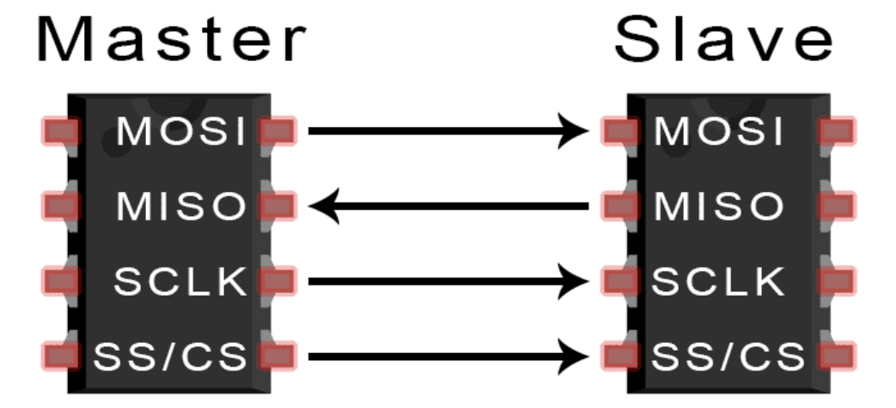
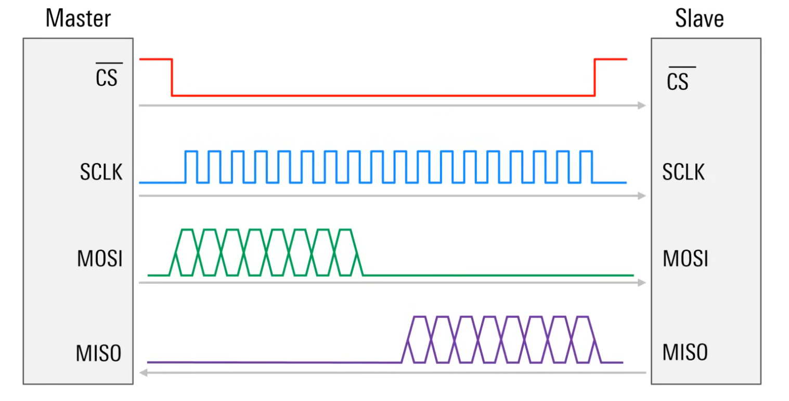
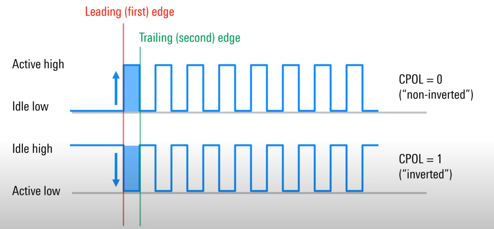
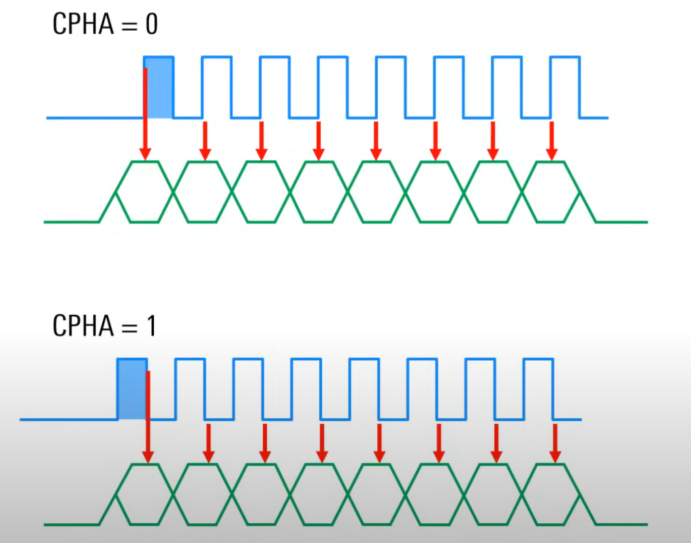
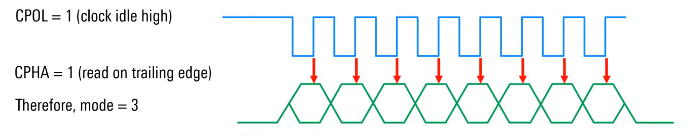
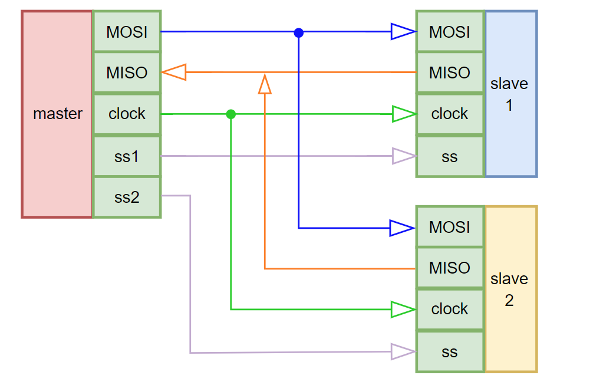
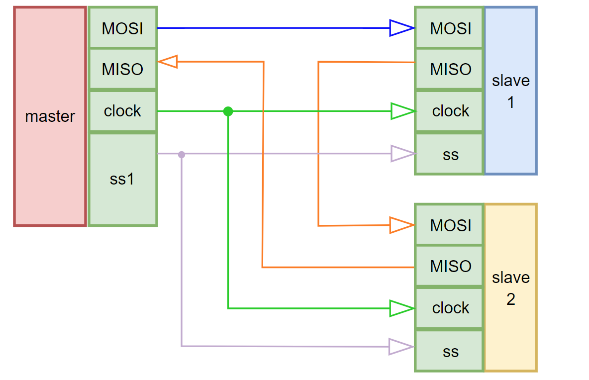

SPI (Serial Peripheral Interface) is a low-speed four-wire master-slave full-duplex serial protocol, widely used as a faster alternative to UART/I2C for transferring data between an intelligent controller and a less intelligent peripheral device.

## The protocol
A protocol in which there is one `leader` (master or controller) and one or more `slaves` (or peripheral devices). It usually operates in `full-duplex` (both nodes transmit data simultaneously), and message exchange occurs in `frames`. SPI has no agreement on frame formats, number of transmitted bits and voltage levels.

### The four lines

- the `CS` (Chip Select) / `SS` (Slave Select) channel is used to select the slave
- clock signals on the `SCLK` line are used for synchronization
- `MOSI` (Master Out Slave In) data is transmitted from the master to the slave
- `MISO` (Master In Slave Out) data is transmitted from the slave to the master

A transfer runs in four steps:
1. switch the **CS** line `low(0)`, indicating that information will be transferred to this slave
2. start the **SCLK** signal
3. the transfer occurs on (**MOSI** / **MISO**)
4. switch **CS** back to `high(1)`

#### SCLK
After **CS** is set to `low(0)`, the master starts generating a clock signal. That way the slave does not need a clock signal of its own and uses the master clock instead. The clock is usually in `Mhz`, and it tells the slave at what moment to `start reading` the voltage level on the data line.

The clock signal in SPI can be `idle` in a `low(0)` or a `high(1)` state, and data can be read on the **rising** or **falling** edge of the signal.

#### MOSI
Used to send data from a master to a slave. After **CS** is pulled `low(0)` and **SCLK** is enabled, **MOSI** transfers data from the master to the slave as `8-bit` bytes, where the first bit can be the least significant bit (LSB or MSB). Multiple bytes can be transferred while **CS** is `low(0)`.

#### MISO
Used to send data from a slave to a master. It is often used to respond to data received from **MOSI**.

Since only the master can **hold the clock**, the master must know exactly how many bytes the slave wanted to send over **MISO**. That can be a `fixed number`, or a number the master answers with when the slave asks for it.

## Clock polarity and phase

### Clock polarity
**CPOL** says what the clock signal generated by the master looks like:
1. `low(0)` at idle, active at `high(1)` level (`CPOL = 0`, "non-inverted"), leading (first) edge `rising`
2. `high(1)` at idle, active at `low(0)` level (`CPOL = 1`, "inverted"), leading (first) edge `falling`

For both types of clock pulse polarity you can focus on two moments:
1. the leading edge of the clock pulse (leading, first edge)
2. the trailing edge of the pulse (trailing, second edge)

### Clock phase
**CPHA** determines on which edge the nodes read data.
1. `CPHA - 0` means that data will be read on the `rising` edge of each clock signal
2. `CPHA - 1` means that data will be read on the `falling` edge of each clock signal

### SPI mode
The operation of the master and the slave must be coordinated via the SPI operating mode. The mode is an integer combination of CPOL and CPHA.

| Mode | CPOL | CPHA |
|---|---|---|
| 0 | 0 | 0 |
| 1 | 0 | 1 |
| 2 | 1 | 0 |
| 3 | 1 | 1 |

### Multi-slave configuration

#### Independent slaves

In this configuration the master has a `separate CS` line for **each slave**, and the remaining channels are shared on the bus. The method is relatively simple until there are many slaves.

#### Cooperative slaves / daisy chain

With this configuration the master has `only one CS line`, which is used by all slave devices. Data on **MOSI** is always sent to the `first slave`, and data transfer to another slave happens through the **MISO** of the first slave that received data on **MOSI**, and so on down the chain.

If a slave wants to send data to the master through its **MISO** channel, it also sends it to the `next slave` in the chain, and so on until it reaches the `last one`, whose **MISO** channel is not connected to the next slave but to the `master`.

The cooperation mode reduces the required number of lines, but it is more complex and may not be supported by some devices.
