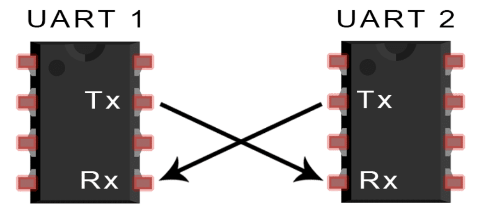
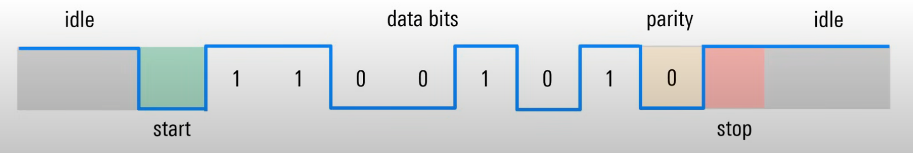

UART (Universal Asynchronous Receiver / Transmitter) is a low-speed two-wire asynchronous multi-duplex serial protocol. It is the earliest serial protocol and is still commonly used in modern electronics.

## The protocol
UART is simple, inexpensive and easy to implement. It transmits and receives data over two wires: `TX` (transmit) and `RX` (receive).

Asynchronous means that the transmitter and receiver `do not share a common clock signal`, which simplifies the protocol by removing the separate synchronization line. It also imposes its own requirements: `the speed must be the same` on both sides. Speed is measured in bauds (bits per second), and the baud rate has to be configured the same on both sides. Common speeds include `4800`, `9600`, `19200`, `38400`, `57600`, `115200` baud and higher.

In addition, both nodes must use a fixed message structure and know how many bits are in each frame and what they mean.

UART can connect **only two nodes**. Two data transmission wires are used for this, one connecting the transmitter of one node to the receiver of the other, the other the other way around. In this configuration data exchange can be:
1. `simplex`: only in one direction (TX -> RX)
2. `half-duplex`: at the same time, either transmission or reception of data can occur (Tx -> RX, RX -> TX)
3. `full-duplex`: both nodes transmit data simultaneously (TX <-> RX)

## UART frame format
The `high(1)` level consists of the `start` and `stop` bits, the `data` bits and an optional `parity` bit. When data is not transmitted (`idle`), the line is in `high(1)` state.

### Start and stop bits
The transmitter must inform the receiver that the data is ready to be transmitted. The **start bit** is a transition from the idle `high(1)` state to `low(0)`.

After sending the data there is a **stop bit**, which means that the sending is complete. The **stop bit** either transitions from `low(0)` to `high(1)` state, or simply leaves the state `high(1)`.

### Data bits
Useful information comes immediately after the start bit. There can be from `5` to `9` bits, but most often `7-8 bits`. These bits are usually transmitted with the least significant bit at the beginning (`LSB first`).
- 7-bit ASCII 'S' = 1010011
- LSB order = 1100101

### Parity bit
Used to detect `errors` in the transmitted message, the parity bit sits between the `last data bit` and the `stop bit`. Its value depends on the **type of parity** used.
- even parity: the number of `1` in the data frame must be even. When sending `1100101`, the parity bit will be `0`, because there is already an even number of `1`.
- odd parity: the number of `1` must be odd. When sending `1100101`, the parity bit will be `1`, because the frame must contain an odd number of `1`.

A parity bit can detect only **one error**. If there are more, the bit will not detect them.
