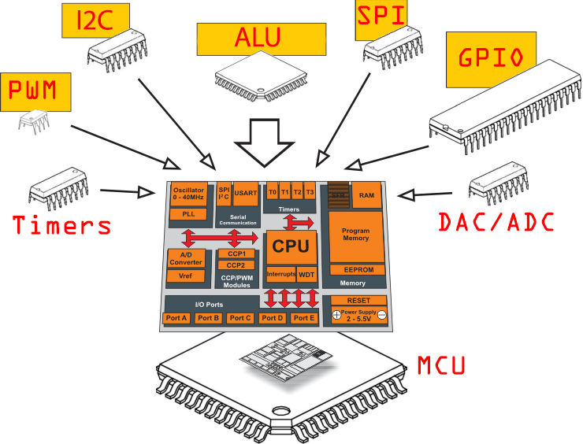

Microcontroller peripherals are functional blocks integrated into the chip that enable it to interact with the outside world or carry out specific tasks, often without involving the processor core.

When choosing a microcontroller, pick the one whose peripherals fit the job.

The **peripherals of a microcontroller** act like its **senses**, enabling it to interact with the outside world, process analog signals, manage time, communicate with other devices, and perform various application-specific tasks.

Each microcontroller includes a different set of **peripheral modules**, depending on its architecture, manufacturer and specific model, and those modules determine its capabilities and cost. Typical peripherals include:
- ADC (Analog-to-Digital Converter)
- Timers and PWM Generators
- Analog Comparators
- Communication interfaces such as UART (serial port), SPI, I2C, USB and CAN

Most microcontrollers, regardless of brand or architecture, include a core set of these essential peripherals.

| Category | How it can be different | MCU examples |
|---|---|---|
| GPIO | Number of pins, alt-functions, open-drain/push-pull, switching speed, pull-up resistors. | `STM32F103`: basic set, alt-functions via AFIO `ESP32S3`: up to 45 pins, flexible routing via GPIO matrix `RP2040`: 30 GPIO, PIO support |
| TIMER / PWM | Bit depth (8/16/32 bit), number of timers, modes (OneShot, PWM, Capture), channels, dead-time. | `STM32H7`: advanced timers with dead-time, synchronization `RP2040`: 8 PWM blocks with independent channels `ATmega328P`: 3 timers (2×8 bit, 1×16 bit) |
| UART / USART | Number of ports, DMA support, auto-detection of speed, support for IrDA, LIN, RS-485. | `STM32F4`: up to 6 USARTs, IrDA and SmartCard support `ESP32`: 3 UARTs, all with DMA `RP2040`: 2 UARTs, software implementation via PIO |
| SPI / I2C | Number of modules, speed (up to 80+ MHz), master/slave modes, DMA support, multi-master. | `STM32L4`: SPI with CRC and NSS support `ESP32S3`: up to 4 SPI/I2C, with DMA and master/slave modes `AVR ATmega328P`: I2C (TWI) and SPI with basic functionality |
| ADC / DAC | Bit depth (8-16 bit), number of channels, speed, built-in buffers, calibration. | `STM32G4`: 16-bit ADC, 2 MSPS `ESP32`: 12-bit ADC (low quality), 2 DAC `RP2040`: 12-bit ADC, no DAC |
| DMA | Number of channels, peripheral support, linked list, circular mode, prio levels. | `STM32F4`: up to 16 DMA channels, peripherals + memory `RP2040`: 12 channels, programmable transfers `ESP32`: built-in DMA controller with SPI/UART |
| USB | Support for host/device/OTG mode, protocols (CDC, HID, MSC), built-in or external PHY. | `STM32F103`: USB FS device `STM32H7`: HS + FS, OTG `ESP32S3`: USB OTG (host + device) |
| Wi-Fi / BLE | Version support (BLE 4.2/5.0), co-existence, built-in stack or external module. | `ESP32S3`: Wi-Fi 2.4 GHz, BLE 5.0 `nRF52840`: BLE 5.3, Thread/Zigbee `STM32WB`: STM32 + BLE on a single chip |
| RTC / WDT / Power | External quartz support, wakeup from sleep, low power, independence from system clock. | `STM32L4`: RTC + deep sleep `ESP32`: ULP core, wake-on-touch `AVR`: the simplest WDT, deep sleep with interrupts |
| Specialized | PIO, machine vision, crypto modules, LED drivers, graphic accelerators, LCD controllers. | `RP2040`: 2 PIO blocks `ESP32S3`: AI acceleration + LCD controller `STM32H7`: ChromART GPU, JPEG decoder |

## Usage examples

| Device | Peripherals involved |
|---|---|
| Smart lamp | GPIO, PWM, UART (for BLE), ADC (for light sensor) |
| Weather station | I2C (sensors), ADC (analog sensors), UART (screen), RTC |
| Robot on wheels | PWM (motors), UART (Bluetooth), SPI (IMU), GPIO |
| Oscilloscope on MCU | ADC, DMA, SPI display, USB |

## Tips for working with peripherals

- Use **HAL libraries** or **register access** depending on the task.
- Always **initialize peripherals correctly**: setting up pins, frequencies, interrupts.
- Handle errors: buffer overflows, loss of synchronization, etc.
- Use the datasheet of the microcontroller. Everything is described there in detail.
