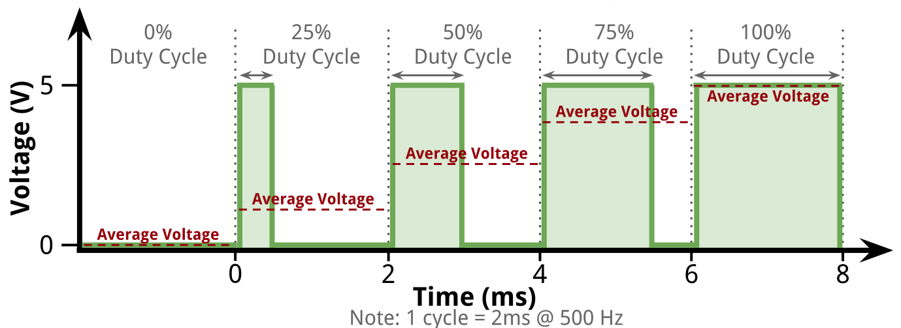
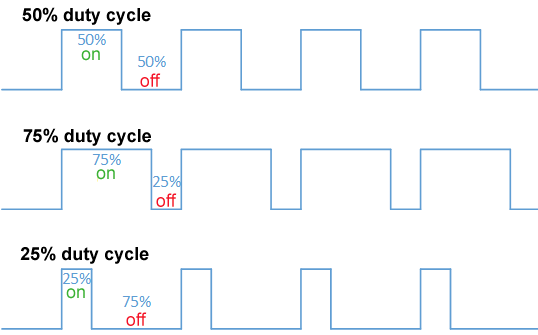
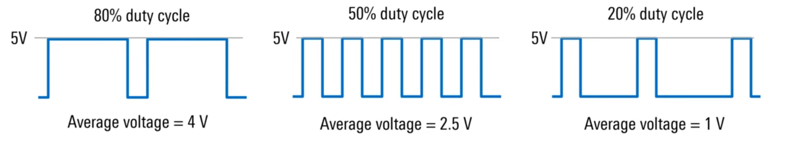

**PWM (pulse width modulation)** is used to control the power supplied to the load.

The classic way to do that is to reduce the voltage through a rheostat or a potentiometer. That is inefficient, since part of the energy is lost as heat.

The PWM method supplies the voltage in short pulses with a fixed amplitude. Instead of changing the voltage, the **duty cycle** changes: more on time means more power, less on time means less power. This control method is efficient and causes almost no losses.

## What it is used for

- mainly used to control the power supplied to the device.
- in some cases it can be used to transmit information for configuring the device.
- has a low power loss and the ability to be digitally or software controlled.

## Main parameters

PWM has two main parameters:
- Frequency (switching frequency, `Hz`)
- Duty cycle (percentage of time in the "HIGH" state, from `0%` to `100%`)



## Duty cycle
The duty cycle is the percentage of time during which the **signal is active**. A signal with a 20% duty cycle is active 20% of the time, one with 50% is active half the time, and one with 80% is active 80% of the time.

The duty cycle can be set or controlled in `3 main ways`:
- manual, with various knobs or sliders
- automatic, for example using feedback on the output voltage in a pulse power supply
- software, using some kind of intelligent system that changes the pulse width depending on external logic or parameters



### Average voltage level
PWM is often used to vary power by changing the `average voltage level` across a load.
- average load = `peak voltage`(5V) * `duty cycle`(20%) = 1V



## Switching frequency
The switching frequency is defined as the reciprocal of the time between the leading edges of the voltage pulses.

The required switching frequency depends on the load or the application area.
- it can be from `10 Hz` to several `kHz`
- for applications where faster or more precise control is required, higher switching frequencies are used
- in most applications the switching frequency **is fixed**

Signals can have the same duty cycles and different switching frequencies.

## Examples of PWM systems

| System | Description |
|---|---|
| 1. Visual Devices | Screen brightness control (high frequency to avoid flickering)<br>RGB LED color control |
| 2. Audio | Digital to analog conversion via filtering<br>Use efficient Class D amplifiers |
| 3. Switching Power Supplies (SMPS) | The basis of switching converters<br>Use MOSFETs to switch pulses |
| 4. DC Motors | Fan or pump speed control<br>Lower duty cycle → lower speed<br>Inertia smooths out operation |
| 5. Servos | PWM sets position, not speed<br>Pulse width corresponds to deviation from neutral<br>Power is supplied via a separate channel |
| 6. Inverters (DC→AC) | Generating an alternating signal from PWM pulses |
| 7. Chargers | Charging batteries (including from solar panels)<br>PWM regulates average voltage to prevent overcharging and reverse current |

## Embedded Rust approach

1. A HAL library (e.g. `stm32f1xx-hal`, `rp2040-hal`, `esp32-hal`) provides the API to the peripherals.
2. `PWM` is usually implemented via **timers (TIM)**.
3. Each `PWM` channel is assigned a `GPIO` pin and a timer.

## General flow of creating PWM in Rust

1. Access `PWM` slices (`Slices::new`)
2. Configure `PWM7` (it controls the `GPIO15` pin)
3. Configure channel B of this `PWM` (the channel connected to `GPIO15`)
4. Connect `GPIO15` to `PWM` as **output**
5. In the loop, change the duty cycle value to get the breathing effect

## Implementation: RP2040

```rust
use rp2040_hal::{self as hal, pwm::Slices};

    // PWM Slices Init
    let pwm_slices = Slices::new(pac.PWM, &mut pac.RESETS);
    // Get 7th slice (controls GPIO 14 (A) and GPIO 15 (B))
    let mut pwm_slice = pwm_slices.pwm7;

    pwm_slice.set_ph_correct(); // Phase correct mode = smoother signal
    pwm_slice.set_top(255); // 8-bit duty cycle precision
    pwm_slice.enable(); // enable slice

    // Get channel_b from 7th slice
    let mut channel_b = pwm_slice.channel_b;
    // Make channel_b output to 15th pin
    let _pin = channel_b.output_to(pins.gpio15);

    let mut duty: i16 = 0;
    let mut step: i16 = 1;

    loop {
        let _ = channel_b.set_duty_cycle(duty as u16);
        timer.delay_us(1000);

        duty += step;
        if duty >= 255 || duty <= 0 {
            step = -step;
        }
    }

```

## Tips for working with PWM

- Do not exceed the frequency. Some devices work up to `1-10 kHz`.
- **PWM resolution** depends on the timer (8/10/12/16 bit).
- For **multi-channel PWM** use different channels of the same timer or timers.
- Use a **logic analyzer** or **oscilloscope** for visualization.
- Timers often work asynchronously, so glitches at startup are possible.
- For **silent PWM** (LED) use frequencies above `1 kHz`.
