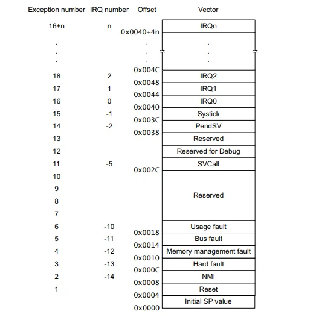
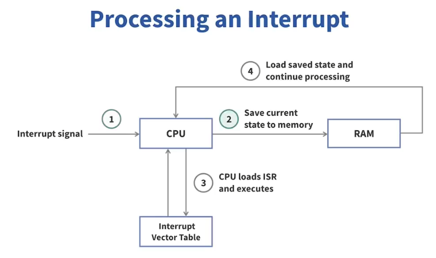

An interrupt lets the microcontroller respond to an important event without spending cycles polling its peripherals. When one fires, the CPU suspends the current task, runs the Interrupt Service Routine (ISR), and returns to where it left off.

## What interrupts are for

- Real-time response: a timer has expired, data has arrived via UART, a button has been pressed.
- Power saving: the MCU can sleep and wake up only on an interrupt.
- CPU offload: eliminates the need to check event flags in a loop.

## What can raise an interrupt

- Hardware events: a GPIO pin state change, UART data transfer completion, a timer expiration.
- Software events: errors such as division by zero or an access to inaccessible memory.

## How interrupts are classified

### By source

- External interrupts: caused by external events, such as pressing a button or changing the signal level on a pin.
- Internal interrupts: initiated by peripheral modules inside the MCU, such as timers, ADC (analog-to-digital converter), UART.

### By processing method

- Vector interrupts: each interrupt source has its own unique handler. This is typical for most modern MCUs, such as ARM Cortex-M.
- Non-vector interrupts: all interrupts are handled by one common function, which then determines the source of the event.

### By priority

- Fixed priority: the processing order is set by hardware and cannot be changed.
- Programmable priority: the developer can configure interrupt priorities, which is especially useful in complex systems.

## The IVT and the vector table

Interrupts are handled by `Interrupt Service Routines`, which are ordinary functions. The hardware knows which function to call for which interrupt because those addresses live in the `IVT` (interrupt vector table), a data structure that maps each interrupt type to the address of the corresponding handler.

Here we see the vector table of our `Cortex-M3`. It shows each interrupt and its corresponding location in memory. When the system starts, the initialization code specifies the necessary functions in the `IVT`.



## How the CPU handles interrupts

At a high level:



1. When an interrupt is triggered, the CPU receives a signal to handle it. The CPU will probably be busy with some other work. However, we want it to continue where it left off after handling the interrupt.
2. To do this, the CPU saves the current execution state, which includes the registers and the current address of the current instruction.
3. It then looks up the `IVT` to find the memory address of the `ISR`, and then executes it.
4. It then restores the interrupted execution state from `RAM` and continues.

## Interrupt priorities

What happens if we have multiple interrupts firing at the same time? We handle them by priority.

Interrupts have a priority associated with them. When multiple interrupts fire, the interrupt with the highest priority is handled first. Furthermore, a higher priority interrupt can even interrupt a lower priority interrupt.

This ensures that critical interrupts are handled in a timely manner. This is especially useful in hard real-time systems where they are the upper bounds of worst-case performance.

## How to set up an interrupt in an MCU

There are several steps to using interrupts in an MCU:

1. Enabling interrupt: enable the interrupt for the desired source, for example in the timer or GPIO settings.
2. Setting priority: if the MCU supports programmable priorities, set the priority level for this interrupt.
3. Writing a handler: create an `ISR` function that will be executed when an interrupt occurs.
4. Registering a handler: in some architectures, for example `ARM Cortex-M`, specify the handler address in the vector table.

## NVIC (nested vectored interrupt controller)

Many modern MCUs are based on the `ARM Cortex-M` architecture, where interrupt management is performed via the `NVIC` (Nested Vectored Interrupt Controller). Let's consider its features:

- Vector table in memory
- Priorities from 0 (highest) to 255 (lowest)
- Nested interrupts: high-priority ones can interrupt an ISR
- Tail-chaining: instant transition from one ISR to another without returning to the main code

## Example in Rust (STM32)

```rust
use cortex_m_rt::interrupt;

#[interrupt]
fn TIM2() {
    // TIM2 timer interrupt handling logic
    // For example, clearing the interrupt flag or performing an action
}
```

`#[interrupt]` is the ISR designation, indicating that the function is an interrupt handler. `TIM2` is the interrupt name corresponding to the TIM2 timer, according to the vector table.

## Safety: critical sections

Interrupts can interfere with the main code. To protect shared data:

### A simple way is to temporarily disable interrupts

```rust
use cortex_m::interrupt;

interrupt::free(|_| {
    // Critical Section: Safe Access
});
```

### `Mutex` and `RefCell`

```rust
use cortex_m::interrupt::Mutex;
use core::cell::RefCell;

static SHARED_DATA: Mutex<RefCell<u32>> = Mutex::new(RefCell::new(0));

#[interrupt]
fn EXTI0() {
    interrupt::free(|cs| {
        let mut data = SHARED_DATA.borrow(cs).borrow_mut();
        *data += 1;
    });
}
```

## Interrupt handling guidelines

- Minimize time in ISRs: keep handlers short so as not to block other interrupts or the main program.
- Avoid blocking: do not use delays or other blocking operations in ISRs.
- Use flags: pass data from ISRs to the main program via flags or queues.
- Clear flags: make sure the interrupt flag is cleared in the ISR if required.
