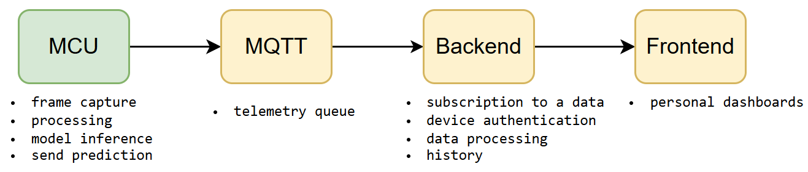

This series covers the building of an ESP32-S3 device with ML built right into the firmware, along with the decisions, compromises, and challenges that came up along the way.

## Why I took this on

The reasons are simple and honest.

1. It's an objectively difficult challenge. I don't have extensive, multi-year experience working with microcontrollers, and my knowledge of ML is only basic. That is precisely why the idea seemed interesting: it's a task with many unknowns, and it requires combining different skills into a single system.
2. I want to improve my Rust skills. I've been using Rust for a long time, and it has become my primary tool for many projects, so the choice for firmware was obvious: Rust gives safety, control and predictability, and it is a sign of engineering quality. I also want to show that Rust firmware is not exotic, but a fully functional approach.
3. Build a full cycle: MCU → AI → Actix Web → Dashboard. Narrow specialization is being replaced by generalist engineers who understand the product as a whole, and I am interested in following the entire IoT product journey: assembling the hardware, integrating TinyML inference, setting up Wi-Fi and MQTT, processing data on the server, displaying statistics and graphs on the dashboard. I want to cover the entire stack, from the registry to the UI.
4. Document the journey. I want to record the approaches, the conclusions, the decisions made. This will be useful for me in the future, and perhaps for other developers reading this series, my employers, or my partners.

## What exactly I want to build

The device will contain:

1. AI inference for image classification and human feature detection
2. Camera and image processing stream
3. Wi-Fi connection via QR code with the ability to reset network settings
4. Obtaining UTC time
5. Communication with the server via MQTT

The server side will be responsible for:

1. Authorization processing
2. Collecting and processing data from devices
3. API

On the front end, I see the following as optimal:

1. User/device personal account
2. Real-time event log
3. Graphs and statistics for human detection data
4. Device cards

The main stages of this project are:

* Training and optimizing the machine learning model
* Creating firmware on the MCU and integrating the model into it
* Configuring a transport layer for MCU communication with the outside world
* Creating a server for receiving data, processing it, and managing authorizations
* Data visualization and working with UI/UX
* Creating a prototype enclosure for 3D printing

## Project architecture

## How the article series is structured

I divide the entire journey into logical modules. The series covers:

* Hardware, component selection, and Rust firmware organization
* TinyML and MCU models
* Running inference: the real pipeline
* Network: Wi-Fi, MQTT, HTTP
* Backend on Actix
* Dashboard
* 3D modeling
* Current results and plans
